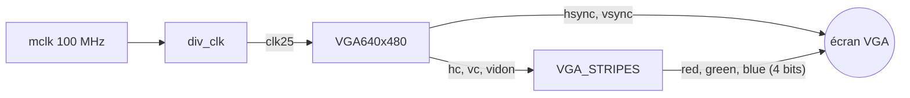
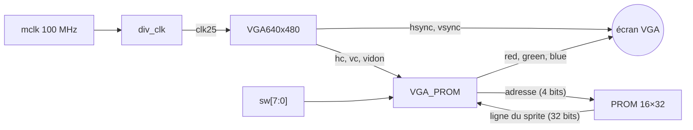
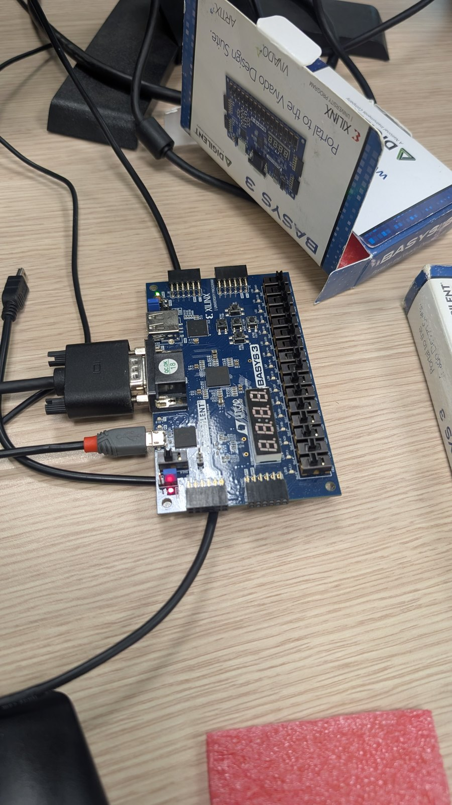
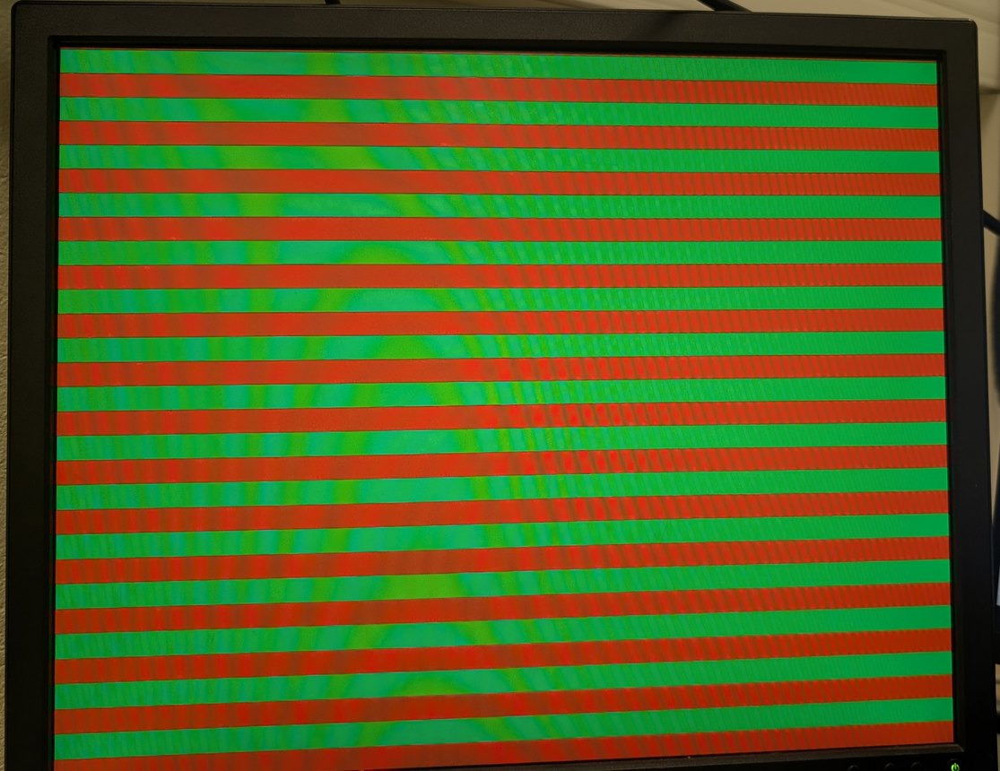
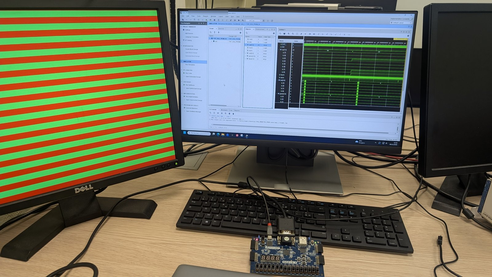
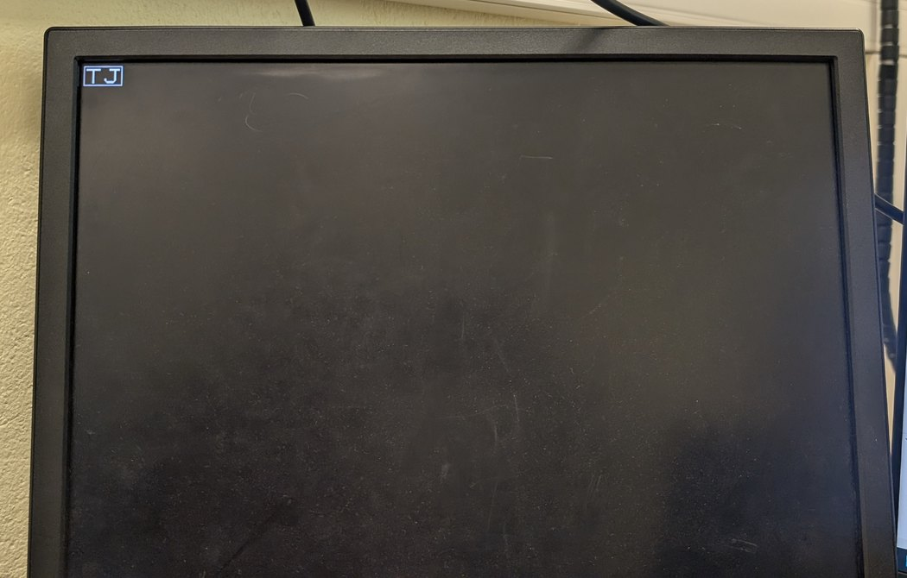
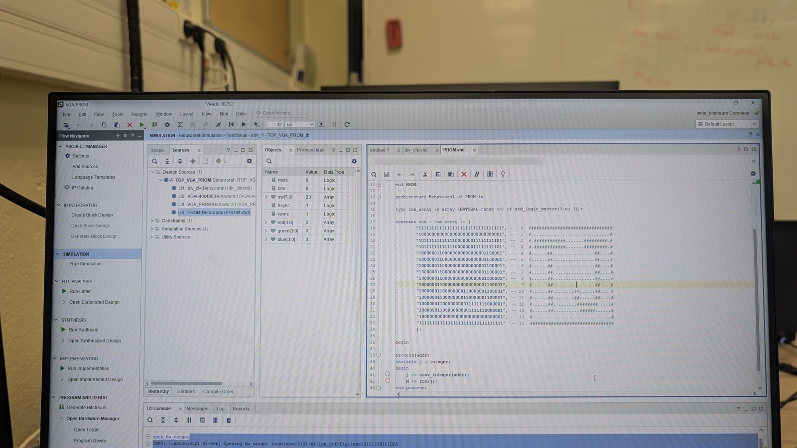
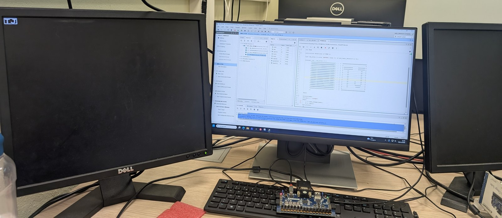
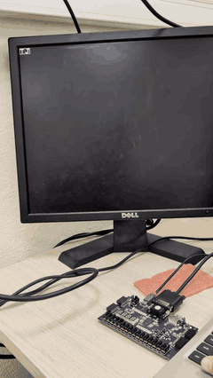

# Driver VGA 640×480 sur FPGA Basys 3 (VHDL)

> *VGA 640×480 @ 60 Hz controller written in VHDL on a Digilent Basys 3 (Artix-7) board, built with Vivado: colour stripes, then a 32×16 sprite stored in a ROM and moved with the switches.*

## Le projet

Travaux pratiques de **Systèmes sur Puce et Systèmes Embarqués** (Master 2 Capteurs, Électronique et Objets Connectés, Université de Montpellier). L'objectif : faire afficher une image sur un écran VGA directement depuis le FPGA, sans processeur, en générant soi‑même les signaux de synchronisation.

- **Carte** : Digilent Basys 3 (Artix‑7 `xc7a35tcpg236-1`), sortie VGA 12 bits (4 bits par couleur)
- **Outils** : VHDL, Xilinx Vivado 2025.2 (synthèse, simulation, programmation)

## Ce qu'on a fait

### TP1 — Bandes de couleur

On génère les signaux `hsync` et `vsync` du VGA 640×480 à 60 Hz à partir de l'horloge 100 MHz de la carte (divisée par 4 pour obtenir 25 MHz, l'horloge pixel). Deux compteurs (`hc` pour la colonne, `vc` pour la ligne) repèrent le pixel courant, et un bloc de couleur affiche des bandes rouge/vert de 16 lignes dans la zone visible.



### TP2 — Sprite stocké dans une PROM

On remplace le bloc de bandes par un petit dessin de **32×16 pixels** (un cadre avec mes initiales « TJ ») stocké dans une mémoire PROM écrite en VHDL. Le bloc `VGA_PROM` calcule, pour chaque pixel de l'écran, s'il tombe dans le sprite, puis lit le bon bit dans la PROM. Les **8 interrupteurs** de la carte déplacent le sprite : `SW0–SW3` pour la position horizontale (pas de 40 pixels) et `SW4–SW7` pour la verticale (pas de 30 lignes).



Le contenu de la PROM (chaque `#` est un pixel blanc) :

```
################################
#..............................#
#.############.......#########.#
#.############.......#########.#
#......##................##....#
#......##................##....#
#......##................##....#
#......##................##....#
#......##................##....#
#......##................##....#
#......##........##......##....#
#......##........##......##....#
#......##.........########.....#
#......##..........######......#
#..............................#
################################
```

### Le VGA 640×480 en chiffres

| Paramètre | Valeur |
|---|---|
| Horloge pixel | 25 MHz (100 MHz ÷ 4) |
| Pixels par ligne | 800 (96 synchro + 48 back porch + 640 visibles + 16 front porch) |
| Lignes par image | 521 (2 synchro + 29 back porch + 480 visibles + 10 front porch) |
| Durée d'une ligne / d'une image | 32 µs / 16,67 ms, soit 59,98 Hz |

## Résultats

### Sur la carte

La carte Basys 3 est reliée à l'écran par un câble VGA.

<p align="center">
  
</p>

**TP1** — les bandes rouge/vert s'affichent sur l'écran (les franges fines sont un effet de moiré de la photo). Sur la seconde photo, on voit le poste complet : l'écran, la simulation dans Vivado et la carte.

<p align="center">
  
  
</p>

**TP2** — le sprite « TJ » s'affiche en haut à gauche de l'écran quand tous les interrupteurs sont à 0, et le code de la PROM est celui ouvert dans Vivado sur la seconde photo.

<p align="center">
  
  
</p>

<p align="center">
  
</p>

### Vidéo : déplacement du sprite avec les interrupteurs

On déplace le sprite sur l'écran en actionnant les interrupteurs de la carte.

[](video/tp2_deplacement_sprite.mp4)

*Cliquer sur l'aperçu pour ouvrir la vidéo complète (32 s, [`tp2_deplacement_sprite.mp4`](video/tp2_deplacement_sprite.mp4)).*

### En simulation

Les chronogrammes ont été relevés sur la simulation et correspondent à ce qui est attendu :

| Mesure | Attendu | Relevé |
|---|---|---|
| Période de `clk25` | 40 ns | 40 ns |
| Période de `hsync` | 32 µs | 32,000 µs |
| `vsync` à 0 | 64 µs | 64,000 µs |
| Période d'image | 16,67 ms | 16,672 ms |
| Pixels visibles par image | 640 × 480 = 307 200 | 307 200 |
| Sprite (interrupteurs à 0) | 188 pixels allumés, colonnes 145 à 176, lignes 32 à 47 | identique à la PROM, pixel par pixel |

## Organisation du dossier

```
05_driver_vga/
├── README.md
├── images/                 photos du montage et des résultats
├── video/                  vidéo du TP2 (et son aperçu)
├── tp1_vga_stripes/        TP1 : sources, testbenches, contraintes .xdc, create_project.tcl
└── tp2_vga_prom/           TP2 : idem, avec PROM.vhd et VGA_PROM.vhd
```

Chaque dossier de TP contient tout ce qu'il faut pour recréer le projet : `create_project.tcl` crée le projet Vivado (`Tools → Run Tcl Script…`), avec comme top de synthèse `TOP_VGA_SPRITES` (TP1) ou `TOP_VGA_PROM` (TP2) et comme top de simulation le testbench `…_tb` correspondant (lancer la simulation sur 35 ms pour voir une image complète).

Le reset est affecté à un bouton de la carte : `BTNR` (TP1) et le bouton central `BTNC` (TP2), voir les fichiers `.xdc`.

## Crédits

Le fichier `VGA640x480.vhd` reprend le code de référence montré en cours (HAE924E, Université de Montpellier). Le reste (division d'horloge, couleurs, PROM, sprite, déplacement, testbenches) est le travail du TP.

## À venir

TP3 : afficher une vraie image depuis une ROM générée avec l'IP *Block Memory Generator* de Xilinx (fichier `.coe`).
